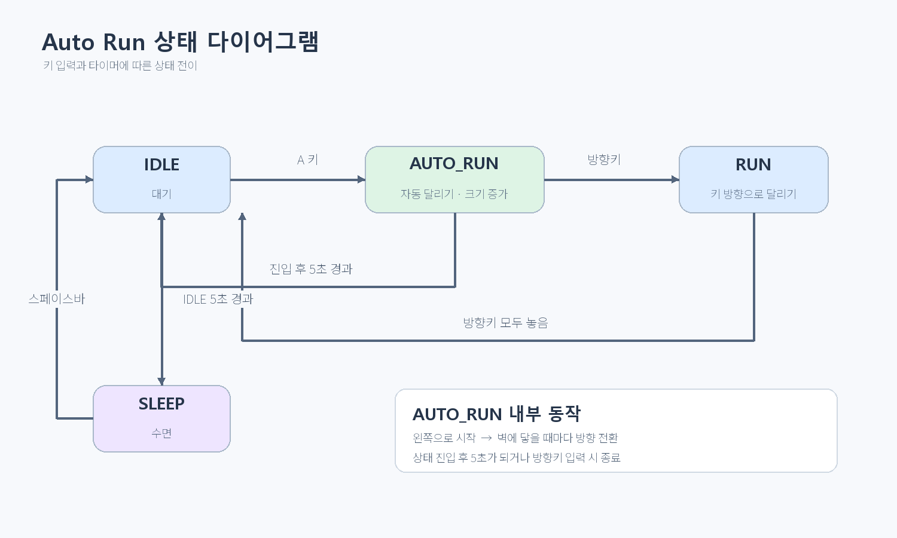
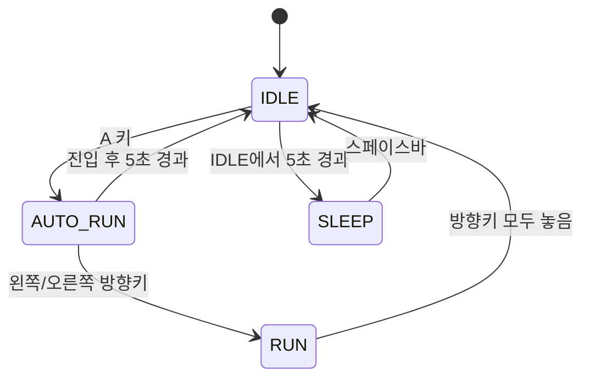

# Auto Run 상태 개발 문서

## 목표

`a` 키로 시작하는 `AUTO_RUN` 상태를 추가한다. 소년은 왼쪽으로 달리기 시작하고, 화면 경계에 닿을 때마다 방향을 바꾸며, 자동 달리기가 유지되는 동안 점점 커진다. 상태 진입 후 5초가 지나면 `IDLE`로 돌아간다. 그 전에 방향키가 눌리면 자동 달리기를 즉시 끝내고 해당 방향의 `RUN` 상태로 전환한다.

## 현재 동작

`boy.py`의 상태 머신에는 `IDLE`, `SLEEP`, `RUN`이 있다.

- `IDLE`에서 5초가 지나면 `SLEEP`으로 전환한다.
- `SLEEP`에서 스페이스바를 누르면 `IDLE`로 돌아간다.
- 왼쪽/오른쪽 방향키를 누르면 해당 방향으로 `RUN`에 진입한다. 모든 방향키를 놓으면 `IDLE`로 돌아간다.
- `main.py`가 키 이벤트를 받아 `Boy`의 상태 전환 메서드를 호출한다.

## 상태 전이 설계

`AUTO_RUN`의 벽 충돌에 따른 방향 전환은 상태 전환이 아니라 해당 상태 안에서 일어나는 동작이다.

## 동작 규칙

### AUTO_RUN 진입

- `IDLE` 상태에서 `a` 키를 누르면 `AUTO_RUN`으로 전환한다.
- 상태에 진입할 때 시작 시각을 기록하고, 달리기 애니메이션 프레임을 초기화한다.
- 첫 이동 방향은 왼쪽(`-1`)으로 설정한다.
- 기존 `RUN`에서 사용하는 달리기 애니메이션과 속도 상수를 재사용한다.

### 이동과 벽 충돌

- 매 업데이트마다 현재 방향과 달리기 속도를 사용해 위치를 갱신한다.
- 위치가 `MIN_X` 또는 `MAX_X` 경계에 도달하면 경계 안쪽으로 위치를 고정하고 이동 방향과 바라보는 방향을 반전한다.
- 반전 시 위치를 경계 안에 고정해 다음 프레임에 화면 밖으로 벗어나거나 벽에서 떨리는 현상을 방지한다.

### 속도 증가

- `AUTO_RUN` 진입 후 경과 시간에 따라 이동 속도를 계속 증가시킨다.
- 속도 배율은 `1 + 경과 시간(초) × 0.5`로 계산한다. 기준 속도는 `Boy.RUN_SPEED`이며, 5초 종료 시점에는 진입 때의 3.5배가 된다.
- 벽에 닿아 방향을 바꾼 뒤에도 증가한 속도를 유지한다. 자동 달리기가 끝나면 일반 `RUN`은 기존 `Boy.RUN_SPEED`를 사용한다.

### 크기 증가

- `AUTO_RUN` 진입 시 크기를 기본 크기로 초기화한다.
- 상태가 유지되는 동안 경과 시간에 따라 그리기 크기를 연속적으로 증가시킨다. 크기 배율은 `1 + 경과 시간(초) × 0.2`로 계산하며, 5초 종료 시점에는 기본 크기의 2배가 된다.
- 크기 배율은 `AUTO_RUN`의 그리기에만 적용한다. 방향키 입력으로 `RUN`에 전환하거나 5초 뒤 `IDLE`로 돌아오면 즉시 기본 크기(100×100)로 표시한다.

### 종료와 입력 우선순위

- 상태 진입 후 5초가 지나면 `IDLE`로 전환한다. 타이머는 `AUTO_RUN` 진입 시점부터 측정한다.
- 자동 달리기 중 방향키를 누르면 타임아웃을 기다리지 않고 즉시 `RUN`으로 전환한다. 왼쪽/오른쪽 키에 따라 이동 방향을 지정한다.
- `RUN` 전환 시 자동 달리기의 크기 증가 효과를 해제한다.
- 방향키를 놓는 동작은 기존 규칙을 따른다. 다른 방향키가 계속 눌려 있으면 그 방향으로 달리고, 모두 놓으면 `IDLE`로 돌아간다.
- 자동 달리기 타임아웃으로 `IDLE`에 진입하면 기존 `IDLE` 타이머를 새로 시작한다. 따라서 그 뒤 `IDLE` 상태가 5초 유지되면 기존 규칙에 따라 `SLEEP`으로 전환한다.

## 구현 범위

1. `boy.py` 상태 머신에 `AUTO_RUN` 상태와 `IDLE → AUTO_RUN`, `AUTO_RUN → IDLE`, `AUTO_RUN → RUN` 전이를 추가한다.
2. `AUTO_RUN` 진입 시각, 이동 방향, 크기 배율을 관리하고 상태 업데이트와 그리기 로직에 반영한다.
3. `main.py`에서 `a` 키를 처리해 자동 달리기를 시작한다. 방향키 이벤트는 `AUTO_RUN` 중에도 기존 `RUN` 전환 경로로 전달한다.
4. `IDLE`, `SLEEP`, `RUN`의 기존 애니메이션과 키 동작이 유지되는지 확인한다.

## 완료 기준

- `IDLE`에서 `a` 키를 누르면 왼쪽으로 자동 달리기가 시작된다.
- 좌우 경계에 닿을 때마다 소년이 경계를 넘지 않고 방향을 바꾼다.
- 자동 달리기 중 소년의 그리기 크기가 시간에 따라 커진다.
- 자동 달리기 중 이동 속도가 경과 시간에 따라 빨라지고, 벽에 닿아 방향을 바꾼 뒤에도 증가한 속도가 유지된다.
- 방향키 입력 또는 타임아웃으로 자동 달리기를 끝내면 크기가 기본 크기로 돌아오고, 일반 달리기 속도도 기존 값으로 돌아온다.
- 자동 달리기 진입 후 5초가 지나면 `IDLE`로 돌아오고 크기가 기본값으로 복구된다.
- 5초가 되기 전에 방향키를 누르면 자동 달리기가 종료되고, 누른 방향으로 `RUN`한다.
- 일반 달리기, 방향키 해제, 수면 및 스페이스바 기상 동작이 기존과 동일하게 유지된다.

## 구현 전 확인 사항

현재 `boy.py`는 `animation_sheet.png`를 로드하지만 프로젝트 파일 목록에는 `run_animation.png`가 있다. 자동 달리기 구현 및 실행 확인 전에 실제 스프라이트 파일명과 경로를 확인해야 한다.
